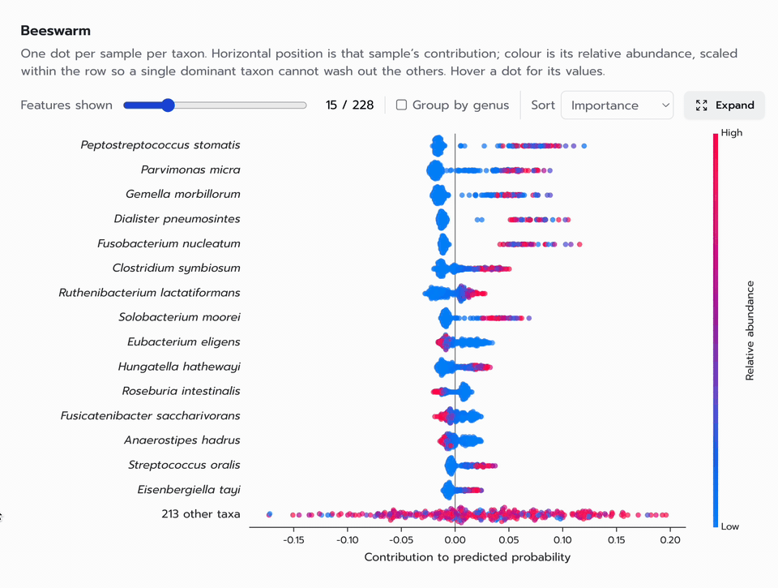
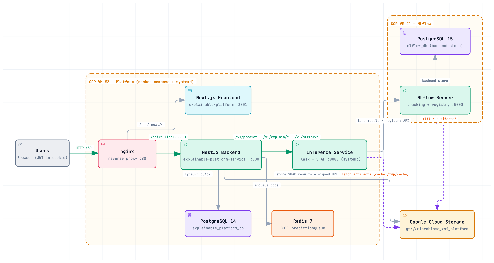
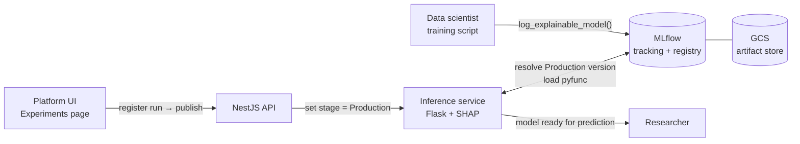
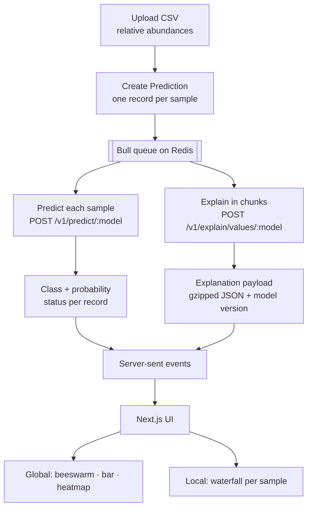
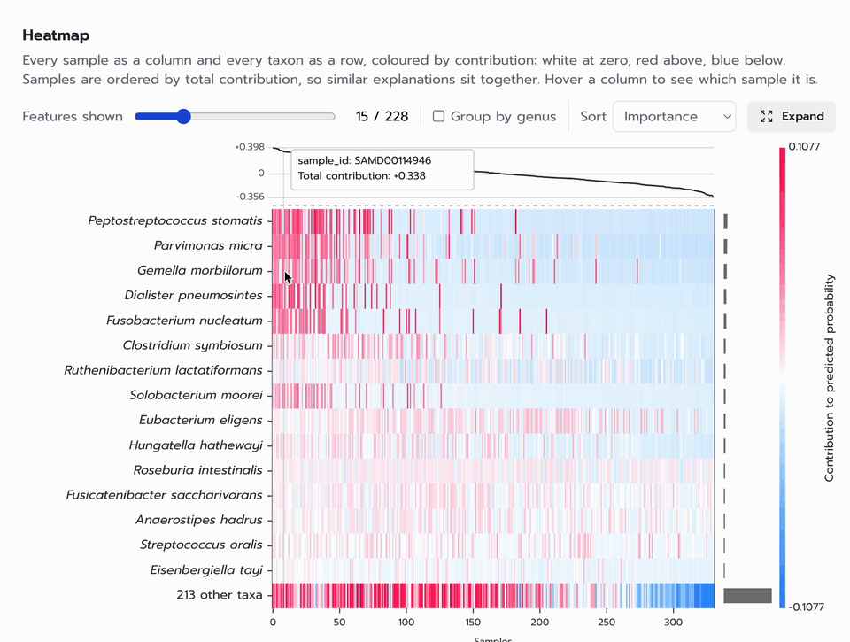
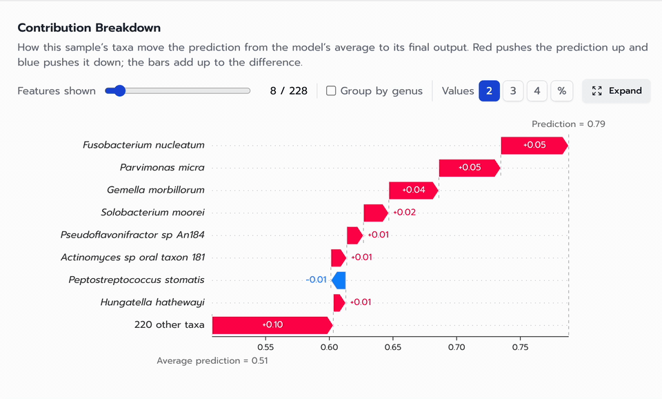
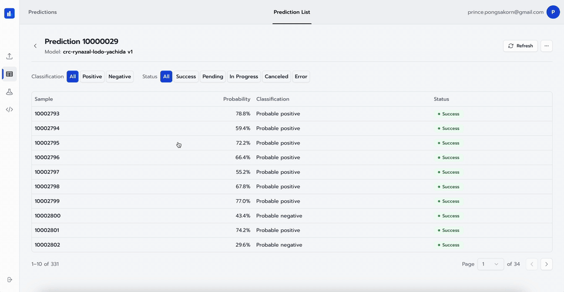

# XAIServe

XAIServe is a platform for predicting disease from gut-microbiome data and explaining each prediction with SHAP. A data scientist trains a model in any Python framework and publishes it from the web UI. A researcher uploads a CSV of relative abundances and gets a predicted class, a probability and a SHAP explanation for every sample, drawn as interactive charts.

The platform was built for the master's thesis *Development of an Explainable AI Platform Using SHAP and Machine Learning via a Usecase of Predicting Diseases from Gut Microbiome Data*.



## What it does

- A model and its SHAP explainer are logged to MLflow as one artifact, so a prediction and its explanation always come from the same model version.
- Random Forest, XGBoost and a PyTorch Graph Convolutional Network all run on the same inference service, which has no framework-specific code.
- Moving a model version to `Production` from the web UI makes it live. The inference service picks up the new version from the registry without a redeploy.
- Each prediction stores the exact model version that produced it.
- Beeswarm, bar and heatmap charts show which taxa drive predictions across a batch, and a waterfall chart explains a single sample. The charts are SVG, drawn in the browser by [`shap-svg`](https://github.com/princepongsakorn/shap-svg).
- An explanation can be read per species or per genus. The genus view sums the SHAP values and abundances of the species in each genus.
- Predictions run as background jobs, and the page updates over server-sent events while they run.

## Components

<picture>
  <source media="(prefers-color-scheme: dark)" srcset="docs/assets/architecture-dark.png">
  
</picture>

| Component | Role | Stack | Directory |
|---|---|---|---|
| Web UI | Upload samples, read explanations, review and publish models | Next.js, React, shadcn/ui, Tailwind, `shap-svg` | [`explainable-platform/`](explainable-platform) |
| Control plane | API, users and tokens, prediction jobs, model publishing | NestJS, TypeORM with PostgreSQL, Bull with Redis | [`explainable-platform-service/`](explainable-platform-service) |
| Inference service | Loads `Production` models from MLflow, returns predictions and SHAP values | Flask, MLflow pyfunc, SHAP | [`kserve-custom-runtime/`](kserve-custom-runtime) |
| Model registry | Tracks runs and model versions, stores artifacts | MLflow with a PostgreSQL backend and a GCS artifact store | [`deployment/`](deployment) |
| Training and model contract | Example training scripts that log explainable models | scikit-learn, XGBoost, PyTorch Geometric, [`mlflow-explainable`](https://github.com/princepongsakorn/mlflow-explainable) | [`mlflow-experiments/`](mlflow-experiments) |
| Load tests | Throughput of the predict and plot endpoints | k6 | [`k6/`](k6) |

## Putting a model on the platform



### 1. Train and log an explainable model

The platform's Developer page shows the MLflow tracking URI and issues an access token. Export them, then train as usual and log the model with [`mlflow-explainable`](https://github.com/princepongsakorn/mlflow-explainable), a small library written for this project (`pip install mlflow-explainable`):

```bash
export MLFLOW_TRACKING_URI=http://<mlflow-host>:5000
export MLFLOW_TRACKING_USERNAME=<username from the Developer page>
export MLFLOW_TRACKING_PASSWORD=<access token from the Developer page>
```

```python
import mlflow
import xgboost as xgb
from mlflow_explainable import log_explainable_model

model = xgb.XGBClassifier(eval_metric="logloss").fit(X_train, y_train)

with mlflow.start_run():
    mlflow.log_metric("roc_auc", roc_auc)
    log_explainable_model(
        model,
        X_train,                      # background data for the explainer
        registered_name="sample-xgboost-crc",
        extra_pip_requirements=["xgboost"],
    )
```

`log_explainable_model` picks the SHAP explainer that suits the model: TreeExplainer for tree ensembles, or a permutation explainer for a custom PyTorch GCN. It saves the predictor and the explainer together as one self-contained `mlflow.pyfunc` artifact. Source files of custom classes, such as a GCN wrapper, go into the artifact too, so the inference service never has to import them.

Every artifact exposes the same two methods:

| Method | Returns |
|---|---|
| `predict(X)` | the probability and predicted class for each sample |
| `shap_explain(X)` | `values`, `base_values` and `data`, in the same shape for every explainer |

The scripts under [`mlflow-experiments/`](mlflow-experiments) are complete examples for each model type.

### 2. Review, register and publish

The Experiments page lists each MLflow run with its parameters and metrics (accuracy, precision, recall, F1, ROC AUC). From there a user can register a run as a named model version, publish that version (move it to the `Production` stage), or unpublish it (move it back to `None`).

### 3. Serving

The inference service loads models by name from `models:/<name>/<Production version>` and never needs to know which framework is behind a model. It caches the version lookup and refreshes it in the background, so a promotion goes live without a restart and no request waits on the registry. Loaded models stay in memory, because unpickling one can take hundreds of MB. If MLflow cannot be reached, the service keeps serving the last version it knew, and it returns 404 only when the registry confirms that no version is in `Production`.

Published models then appear on the prediction page.

## What happens when a researcher submits samples



1. The researcher uploads a CSV of taxa (`Genus_species` columns) and picks a published model. The API parses the file and creates one Prediction, with one Prediction Record per sample. The inference service later lines the columns up with the model's features: it drops extra columns, fills missing ones with 0 and puts them in training order.
2. The work goes on a Bull queue backed by Redis, so a large batch never blocks the API. A job can be cancelled or run again, and a single chart can be regenerated.
3. Each record is sent to the inference service, which returns the predicted class and probability. The record's status (in progress, success, error, cancelled) is stored and pushed to the browser.
4. The samples go to the SHAP endpoint in chunks. A sample's SHAP values do not depend on the other samples in its request, so the chunks join without changing any value, and a failed chunk is retried on its own. The result is stored as one explanation payload. Its fields use the names from `shap.Explanation` (`values`, `base_values`, `data`, `feature_names`), values keep four significant figures, and it records the model version that produced it. [`docs/shap-explain-spec.md`](docs/shap-explain-spec.md) specifies the format.
5. The frontend draws the payload with `shap-svg`. The beeswarm and bar charts show which taxa drive predictions across the batch, and the heatmap shows every sample against every taxon. The waterfall chart shows how one sample's taxa move the prediction from the base value to its final output. Each record also has a comment field for the researcher's notes.







## Example models

| Registered model | Algorithm | Explainer |
|---|---|---|
| `sample-rf-crc` | Random Forest | TreeExplainer |
| `sample-xgboost-crc` | XGBoost | TreeExplainer |
| `sample-gcn-crc` | Graph Convolutional Network (PyTorch Geometric) | Permutation |
| `crc-curatedcrc-rf` | Random Forest on the curatedMetagenomicData CRC cohorts | TreeExplainer |

All of them predict colorectal cancer (CRC) from species-level relative abundance. Sample input files are in [`sample-data/`](sample-data). [`docs/rynazal-2023-reproduction-notes.md`](docs/rynazal-2023-reproduction-notes.md) covers the reproduction of Rynazal et al. (2023).

## Running it locally

You need Docker, Node.js 20, Python 3.12 and a reachable MLflow server. Without `GCS_BUCKET`, the API stores explanations on local disk under `explainable-platform-service/.local-storage/`.

```bash
# 1. PostgreSQL and Redis for the API
docker compose -f explainable-platform-service/docker-compose.yml up -d

# 2. Inference service on :8080
cd kserve-custom-runtime
python3.12 -m venv .venv
.venv/bin/pip install --index-url https://download.pytorch.org/whl/cpu torch
.venv/bin/pip install -r requirements.txt
MLFLOW_URL=http://<mlflow-host>:5000 \
MLFLOW_TRACKING_USERNAME=<username> MLFLOW_TRACKING_PASSWORD=<password> \
  .venv/bin/python kserve-shap-multi-modelserver.py

# 3. API on :3000
cd explainable-platform-service
cp .env.example .env        # then set INFERENCE_SERVICE_URL=http://localhost:8080
npm install && npm run start:dev

# 4. Web UI on :3001
cd explainable-platform
cp .env.example .env.local
npm install && npm run dev -- -p 3001
```

## Deployment

The reference deployment runs on two Google Cloud VMs. The first runs MLflow and its PostgreSQL database, with artifacts in a GCS bucket. The second runs the inference container as a systemd service, and the API, web UI, PostgreSQL and Redis under Docker Compose ([`docker-compose.prod.yml`](docker-compose.prod.yml)) behind nginx. The scripts in [`deployment/`](deployment) set up each VM and redeploy changes.

[`docs/deployment.md`](docs/deployment.md) walks through the whole setup, step by step.

For a Kubernetes cluster with KServe, [`kserve-custom-runtime/deployment/`](kserve-custom-runtime/deployment) has a Secret template and an `InferenceService` manifest for the same inference image. The guide covers that option too.

## Related repositories

| Repository | What it is |
|---|---|
| [`mlflow-explainable`](https://github.com/princepongsakorn/mlflow-explainable) | The Python library that logs a model and its SHAP explainer as one MLflow artifact. Published on PyPI and included here as a submodule under `mlflow-experiments/extension/mlflow_explainable`. |
| [`shap-svg`](https://github.com/princepongsakorn/shap-svg) | The browser chart library the web UI uses to draw SHAP explanations. Published on [npm](https://www.npmjs.com/package/shap-svg). |
| [`MLFlow_Server_GCP`](https://github.com/princepongsakorn/MLFlow_Server_GCP) | A fork of `andrevargas22/MLFlow_Server_GCP` with this project's configuration for an MLflow server on GCP. |

## Citation

The paper describing XAIServe is in preparation. A citation will be added here once it is published.

## License

MIT. See [`LICENSE`](LICENSE).
